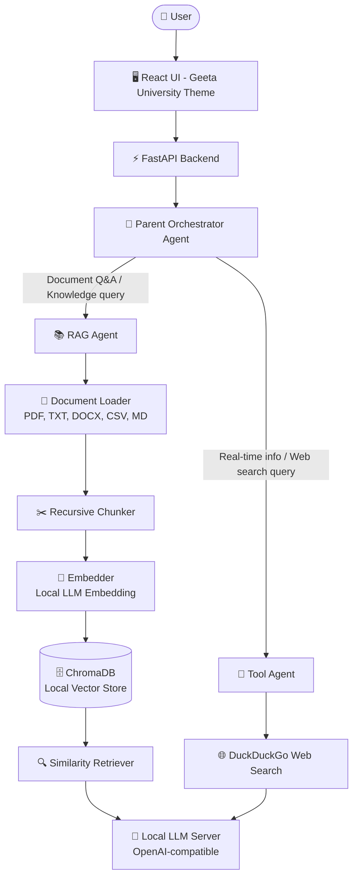

# 🎓 GeetaGPT — Multi-Agent RAG System

An intelligent, multi-agent AI assistant built for **Geeta University**. Features a white UI styled with Geeta University brand colors (Navy Blue & Amber Gold), powered by a local LLM via an OpenAI-compatible API.

---

## 🏛️ Architecture Overview



---

## 🤖 Multi-Agent Hierarchy

1. **Parent Orchestrator Agent (`backend/agents/parent_agent.py`)**
   - Receives all incoming queries from the user.
   - Evaluates whether the request is:
     - Document/curriculum/academic related → routed to **RAG Agent**.
     - Real-time/current events/web lookup related → routed to **Tool Agent**.
   - Includes transparent routing confidence and reasoning metadata returned to the UI.

2. **RAG Agent (`backend/agents/rag_agent.py`)**
   - Loads, chunks, embeds, and stores documents across multiple formats (PDF, DOCX, TXT, CSV, MD).
   - Retrieves top-k relevant semantic chunks from local **ChromaDB**.
   - Generates answers strictly grounded in retrieved document context, citing source documents and page/row numbers.

3. **Tool Agent (`backend/agents/tool_agent.py`)**
   - Connects to **DuckDuckGo Web Search** (no API key required).
   - Performs autonomous search and synthesis for current events, external facts, and live information.

---

## 🎨 UI Design (Geeta University Theme)

- **Primary:** Deep Navy Blue (`#1B3A6B`)
- **Secondary / Accent:** Warm Amber Gold (`#C8A951`)
- **Background:** Clean White (`#FFFFFF`)
- **Cards & Surfaces:** Off-white (`#F8F9FC`)
- **Highlights:** Light Blue Tint (`#E8F0FE`)
- **Agent Badges:** Visual indicators showing which agent handled each response.

---

## 🚀 Quick Start Guide

### 1. Prerequisites
- Python 3.10+
- Node.js 18+
- A running local LLM inference server (e.g., Ollama, vLLM, LM Studio, or LocalAI) with OpenAI-compatible API format.

### 2. Configure Environment (`.env`)
Ensure your `.env` contains:
```env
LLM_BASE_URL=http://localhost:11434/v1
LLM_API_KEY=none
LLM_MODEL=llama3
```

### 3. Backend Setup
```bash
cd backend
python -m venv venv
venv\Scripts\activate   # On Windows
pip install -r requirements.txt
```
Start backend:
```bash
python -m uvicorn main:app --host 0.0.0.0 --port 8000 --reload
# Or run: double-click start_backend.bat
```

### 4. Frontend Setup
```bash
cd frontend
npm install
npm run dev
# Or run: double-click start_frontend.bat
```
Open [http://localhost:3003](http://localhost:3003) in your browser.

---

## 📁 Project Directory Structure

```
GeetaGPT/
├── .env                     # Local LLM endpoint & configuration
├── .env.example             # Template for environment settings
├── start_backend.bat        # 1-click backend runner
├── start_frontend.bat       # 1-click frontend runner
├── backend/
│   ├── main.py              # FastAPI server & endpoints (/chat, /upload, /collections)
│   ├── requirements.txt     # Python dependencies
│   ├── agents/
│   │   ├── parent_agent.py  # Parent Orchestrator
│   │   ├── rag_agent.py     # Document Q&A RAG Agent
│   │   └── tool_agent.py    # Web Search Tool Agent
│   ├── rag/
│   │   ├── loader.py        # PDF, TXT, DOCX, CSV, MD loaders
│   │   ├── chunker.py       # Recursive text splitter
│   │   ├── embedder.py      # ChromaDB embeddings manager
│   │   └── retriever.py     # Similarity search & context builder
│   └── tools/
│       └── web_search.py    # DuckDuckGo search integration
└── frontend/
    ├── index.html           # Main HTML entry with Google fonts
    ├── vite.config.js       # Vite config with API proxy
    ├── package.json         # React & UI dependencies
    └── src/
        ├── App.jsx          # Top-level shell & theme
        ├── main.jsx         # React DOM root
        ├── components/
        │   ├── ChatWindow.jsx    # Chat stream & input
        │   ├── MessageBubble.jsx # Message bubbles & agent tags
        │   ├── FileUpload.jsx    # Drag-and-drop ingestion
        │   └── Sidebar.jsx       # Geeta branding & collections
        └── styles/
            └── theme.css    # Geeta University palette & animations
```

